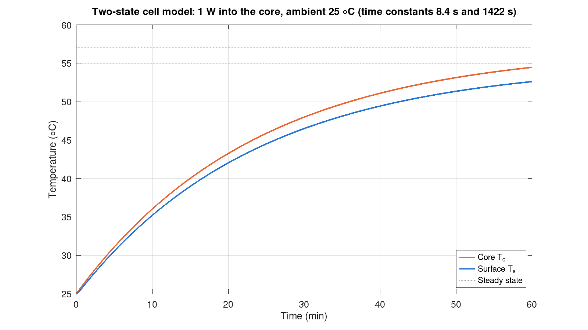
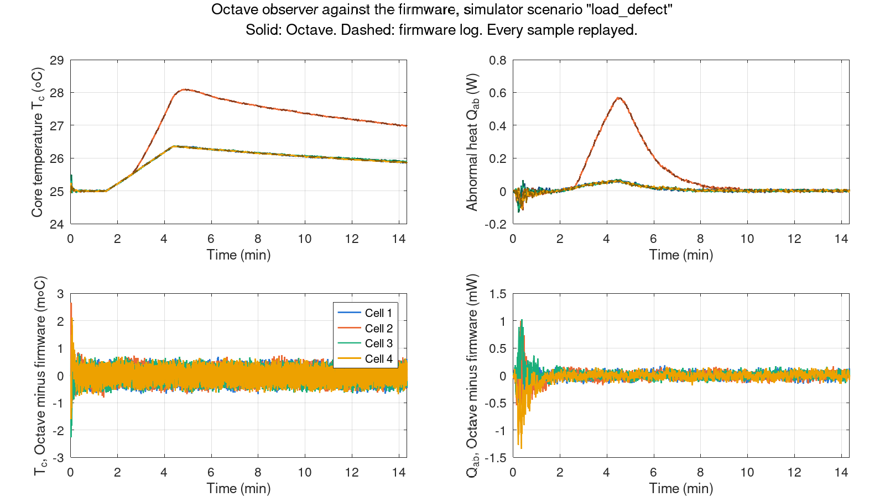
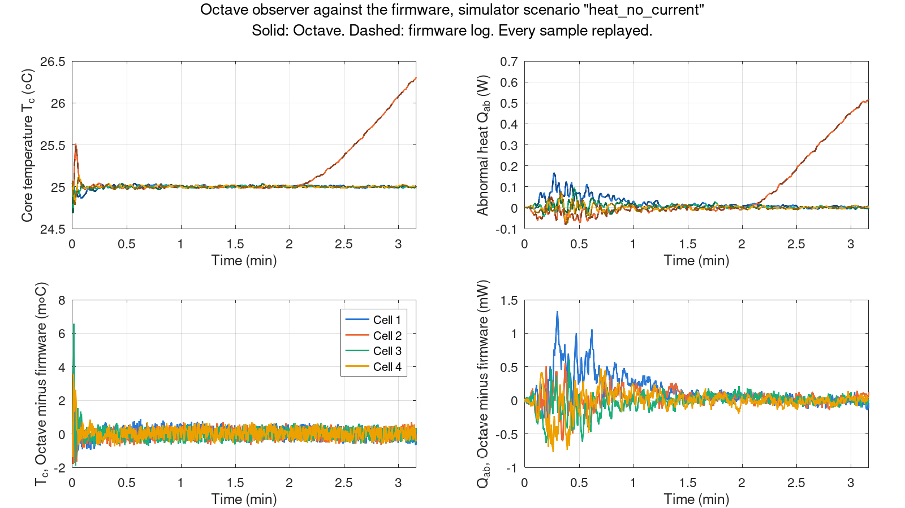

# Model check in GNU Octave (MATLAB-compatible)

These scripts check the supervisor's thermal model (architecture section 9.1) and its Kalman
observer (section 9.2) outside the firmware. They are written a second time, in the `.m`
language, from the firmware's C++ code. Then they are run on the same data as the firmware.
If both give the same numbers, the firmware does what the model says.

The main tool is GNU Octave. It is free and open source. The files use only core functions,
with no toolboxes, so the same files also run in MATLAB.

## Files

| File | What it does |
| --- | --- |
| `bms_params.m` | The model values and the Kalman tuning, copied from the firmware (`types.h`, `config.h`). `bms_params()` gives the firmware's values; `bms_params('simulator')` gives those of the simulated pack. |
| `thermal_discretise.m` | Turns the section 9.1 model into one step of 0.2 s, with the matrix exponential, as the firmware does. |
| `thermal_observer.m` | The section 9.2 Kalman observer of core temperature, surface temperature and abnormal heat. It is a line-by-line copy of the firmware's `CellObserver`, in single precision like the firmware. |
| `thermal_step.m` | One healthy cell with 1 W of heat in its core: the temperatures over one hour and the two time constants. |
| `crosscheck.m` | Runs simulator scenarios, gives the logged sensor readings to `thermal_observer.m`, and compares the result with what the firmware logged. |
| `save_figure.m` | Saves a figure as a 1600 × 900 PNG. |

## Install GNU Octave

- **Windows:** download the installer from <https://octave.org/download> and run it. Use
  "GNU Octave (GUI)" from the Start menu, or `octave --no-gui` in a command prompt.
- **Linux:** install Octave from the distribution (for example `sudo apt install octave`), or
  from Flathub (`flatpak install flathub org.octave.Octave`). Without administrator rights it
  can go into the project's `.tools/` folder with micromamba:

  ```bash
  micromamba create -y -p .tools/sim -c conda-forge octave
  micromamba run -p .tools/sim octave --version
  ```

  Start this copy with `micromamba run -p .tools/sim octave`, so that Octave finds its own
  files. On a PC without a screen, set `QT_QPA_PLATFORM=offscreen` to save the figures.

`crosscheck.m` also needs the PC build of the simulator. Build it once, in the repository
folder:

```bash
cmake -S host -B build/host
cmake --build build/host
```

## Run

From the `matlab` folder:

```bash
octave --no-gui --eval "thermal_step"
octave --no-gui --eval "crosscheck"
```

In the Octave window, change the current folder to `matlab` and type `thermal_step` or
`crosscheck`. `crosscheck({'load_defect'})` runs one scenario. If the simulator is somewhere
else, give its path: `crosscheck({}, 'C:\path\to\bms_sim.exe')`.

The results go to `build/matlab/` (`thermal_step.csv`, `crosscheck.json` and the scenario
logs). The figures go to `docs/build-guide/matlab/`, with a copy of `crosscheck.json` that the
build guide uses.

**The same files run in MATLAB.** Open MATLAB, change the current folder to `matlab`, and type
`thermal_step` or `crosscheck`.

## Results

All of these are simulator results. The thermal values are development values; Gate 9
replaces them with values fitted on the real cells.

### One cell, 1 W heat step (`thermal_step`)

Development values: core 40 J/°C, surface 5 J/°C, core to surface 2 °C/W, surface to air
30 °C/W. Ambient 25 °C. The heat starts at time 0.

| Time | Core temperature | Surface temperature |
| ---: | ---: | ---: |
| 60 s | 26.3428 °C | 26.0682 °C |
| 300 s | 31.1053 °C | 30.5625 °C |
| 1200 s | 43.2515 °C | 42.0252 °C |
| 3600 s | 54.4588 °C | 52.6018 °C |
| steady state | 57.0000 °C | 55.0000 °C |

The two time constants are 8.44 s (the core and the surface layer settle with each other) and
1421.6 s (the whole cell warms to the air). The cell needs more than an hour to settle, so a
fixed temperature limit only acts long after the heat has started. That is why the supervisor
estimates the heat itself.



### The observer against the firmware (`crosscheck`)

The simulator runs the firmware's supervisor on a simulated pack and logs every sample (5 per
second). `crosscheck` gives the logged current, surface temperatures, ambient temperature and
cell resistances to `thermal_observer.m`, and compares its output with the firmware's logged
core temperature and abnormal heat, sample by sample.

| Scenario | Samples | Largest core temperature difference | Largest abnormal heat difference | Result |
| --- | ---: | ---: | ---: | --- |
| `discharge_steps` | 24,600 | 0.0029 °C | 0.0013 W | agree |
| `heat_no_current` | 950 | 0.0066 °C | 0.0013 W | agree |
| `load_defect` | 4,307 | 0.0026 °C | 0.0013 W | agree |
| `soft_short` | 28,501 | 0.0040 °C | 0.0010 W | agree |

The limits are 0.01 °C and 0.002 W. The differences come from the CSV log, which keeps 3
decimals of a temperature and 4 of a power. The largest ones are in the first seconds, while
the observer is still uncertain and follows each reading closely. After the first minute they
stay below 0.001 °C and 0.0005 W. A log written with 7 decimals agrees to 0.0001 °C and
0.0001 W, which is the precision of single-precision arithmetic. For comparison, the abnormal
heat that raises a Warning is about 0.375 W (0.5 °C/min).

If the simulator can only write one row per second, `crosscheck` fills the missing samples by
interpolation and reports the result as approximate. The differences are then up to about
0.025 °C and 0.025 W.




